# Keystone user guide

This guide is for everyone who signs in to Keystone: the people who run the information security management system
(ISMS), the owners of risks and controls, auditors, viewers, and employees who use the employee portal. It explains
each part of Keystone, what it is for and how to use it, screen by screen.

Administrators who install and configure Keystone should also read the [administrator guide](admin-guide.md).

All screenshots show the fictional demo organisation, Alpine Ski House. You can try everything here on the demo (see
[Quick start](../README.md#quick-start)); the screenshots are taken from it by `scripts/guide_screenshots.py`.

## Contents

1. [Getting started](#1-getting-started)
   - [Signing in](#signing-in) · [The guided tour](#the-guided-tour) · [Getting help](#getting-help) ·
     [Finding your way around](#finding-your-way-around)
   - [Search](#search) · [Notifications](#notifications) · [Your account](#your-account) · [Roles](#roles-what-you-can-do)
2. [Working with records](#2-working-with-records): tables, record panels, discussion and history, import, export, delete
3. [Setting up the ISMS](#3-setting-up-the-isms) (ISMS managers and administrators)
4. [Overview](#4-overview)
5. [Compliance](#5-compliance): [Frameworks](#frameworks) · [Controls](#controls) · [Tasks](#tasks) ·
   [Calendar](#calendar) · [Policies](#policies) · [Evidence](#evidence) ·
   [Statement of Applicability](#statement-of-applicability) · [Privacy](#privacy) ·
   [Legal and contract obligations](#legal-and-contract-obligations) · [Exceptions](#exceptions)
6. [Risk](#6-risk): [Risk register](#risk-register) · [Assets](#assets) · [Attack surface](#attack-surface) ·
   [Configuration](#configuration) · [Changes](#changes)
7. [Third parties](#7-third-parties): [Vendors](#vendors) · [Vendor questionnaires](#vendor-questionnaires) ·
   [Vendor assessments](#vendor-assessments) · [Entra exposure](#entra-exposure)
8. [Trust and people](#8-trust-and-people): [People and training](#people-and-training) ·
   [Security training](#security-training) · [People security](#people-security) · [Access reviews](#access-reviews) ·
   [Leaver access check](#leaver-access-check) · [Trust Center](#trust-center) ·
   [Customer questionnaires](#customer-questionnaires) · [Integrations](#integrations)
9. [Operations](#9-operations): [Security reports](#security-reports) · [Incidents](#incidents) · [Business continuity](#business-continuity) ·
   [Nonconformities](#nonconformities) · [Audits](#audits) · [Management review](#management-review) ·
   [Workload](#workload) · [Reports](#reports) · [Physical security](#physical-security)
10. [Settings](#10-settings)
11. [The employee portal](#11-the-employee-portal)
12. [Phones, tablets and dark mode](#12-phones-tablets-and-dark-mode)

---

## 1. Getting started

### Signing in

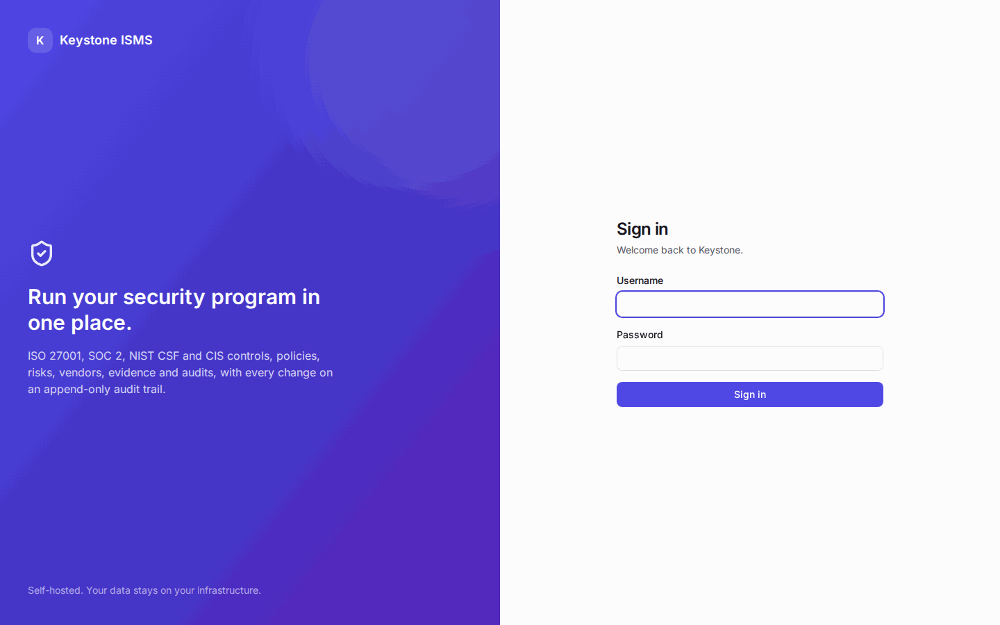

Sign in with the username and password your administrator gave you. Accounts created by an administrator must choose
a new password at the first sign-in (12 or more characters, using three of: lower-case, upper-case, digits, symbols).

- **Single sign-on.** If your organisation uses it, choose **Sign in with Microsoft**, **Google** or **Okta**. The first
  sign-in activates the account an administrator created for you.
- **Invitations.** Employees usually receive an invitation link by email. Opening it lets you choose a password and
  takes you to the employee portal.
- **Locked out?** After five wrong passwords the account is locked for a while. An administrator can reset your
  password.
- You are signed out after a period of inactivity (30 minutes unless your administrator changed it).

### The guided tour

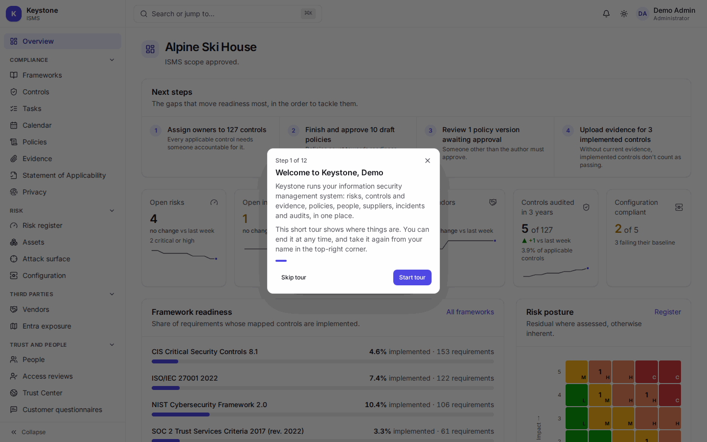

The first time you sign in, Keystone offers a short tour. It points out the search box, each part of the sidebar you
can use, notifications and your account menu.

| To | Do this |
|---|---|
| Go to the next or previous step | **Next** / **Back**, or the → and ← keys |
| End the tour at any point | **Skip tour** / **End tour**, the **×**, or Escape |
| Take it again later | Your name in the top-right corner → **Take the tour** |

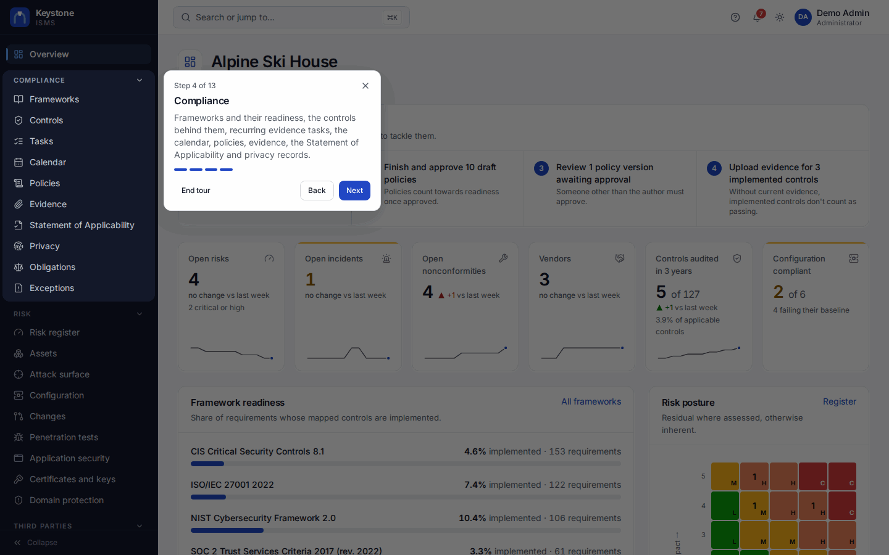

Keystone remembers that you have seen the tour on any device, so it doesn't open again by itself. Employees get a
shorter tour of the employee portal; the **Tour** button in the portal header starts it again.

### Getting help

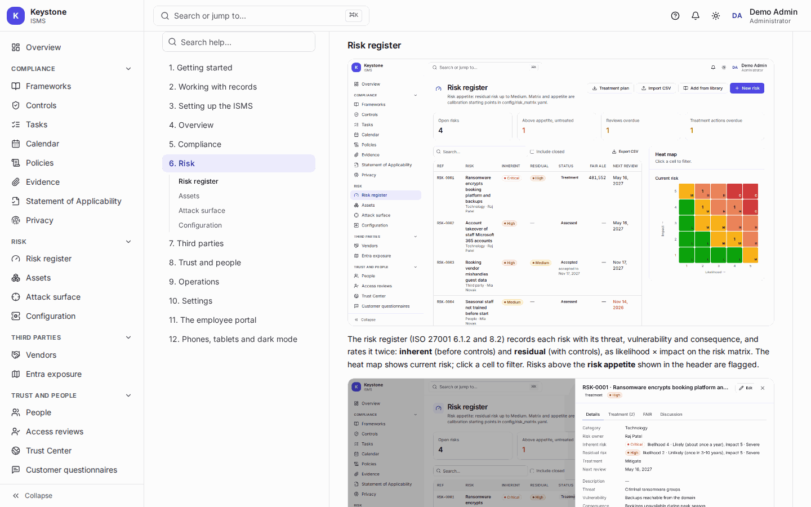

This guide is built into Keystone.

- The **?** button at the top of every page opens the help for that page. On the risk register it opens
  *Risk register*, on Configuration it opens *Configuration*, and so on.
- **Search help** finds every topic that mentions what you type, for example *exception* or *DPIA*.
- Help is also in your name menu (**Help**) and in search (**Ctrl + K**, then *help*).
- In the employee portal, **Help** at the top explains the portal.

### Finding your way around

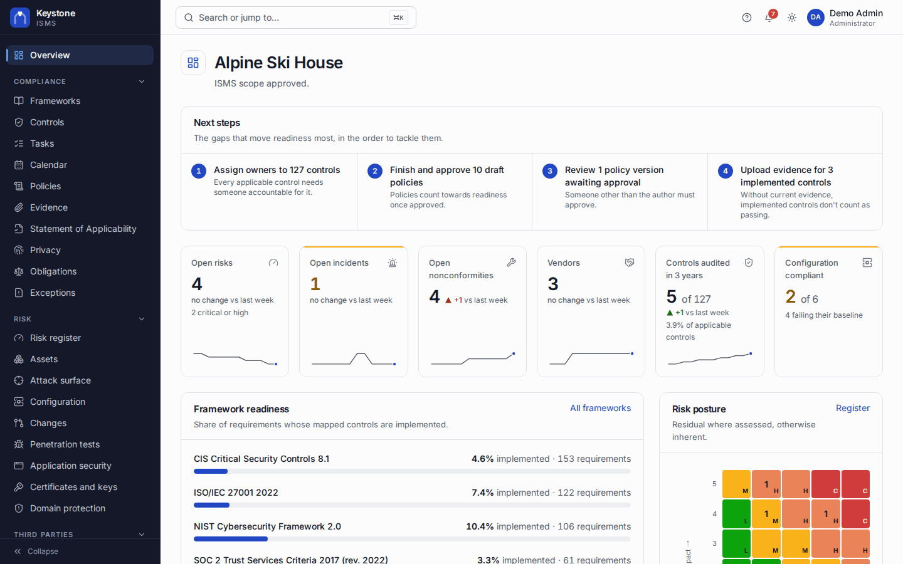

- **Sidebar.** Screens are grouped by area: **Compliance**, **Risk**, **Third parties**, **Trust and people** and
  **Operations**, plus **Overview** at the top and **Settings** at the bottom. You only see the screens your role can
  use. Click a group heading to fold it away (Keystone remembers this), or **Collapse** at the bottom to show icons
  only.
- **Tabs.** Areas with several screens (Vendors, Improvement and Settings) have tabs across the top of the page. Many
  pages also have their own tabs, for example *Records of processing / DPIAs / Data subject requests / Breach log* on
  Privacy.
- **Page header.** Every page starts with its title, a sentence on what it is for, and its main actions on the right
  (for example **New risk**).
- **Top bar.** Search, notifications, the light/dark theme switch and your account menu.

### Search

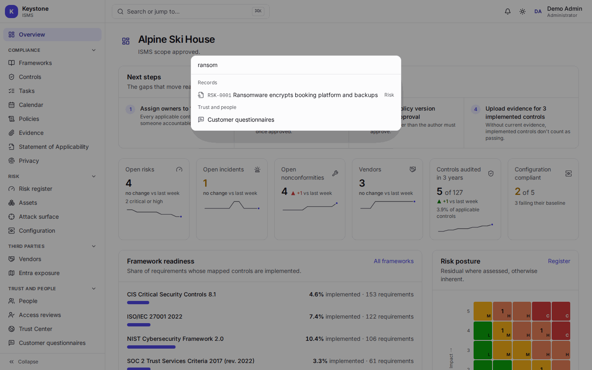

Click **Search or jump to…** or press **Ctrl + K** (**⌘ + K** on a Mac).

- Type a page name to jump to it.
- Type two or more characters to find **records**: risks, controls, policies, tasks, incidents, vendors, assets,
  nonconformities, audits, processing activities, business processes, hosts and firewalls. A reference such as
  `RSK-0012` or `POL-003` goes straight to the record.
- Use ↑ ↓ and Enter to choose, Escape to close.

### Notifications

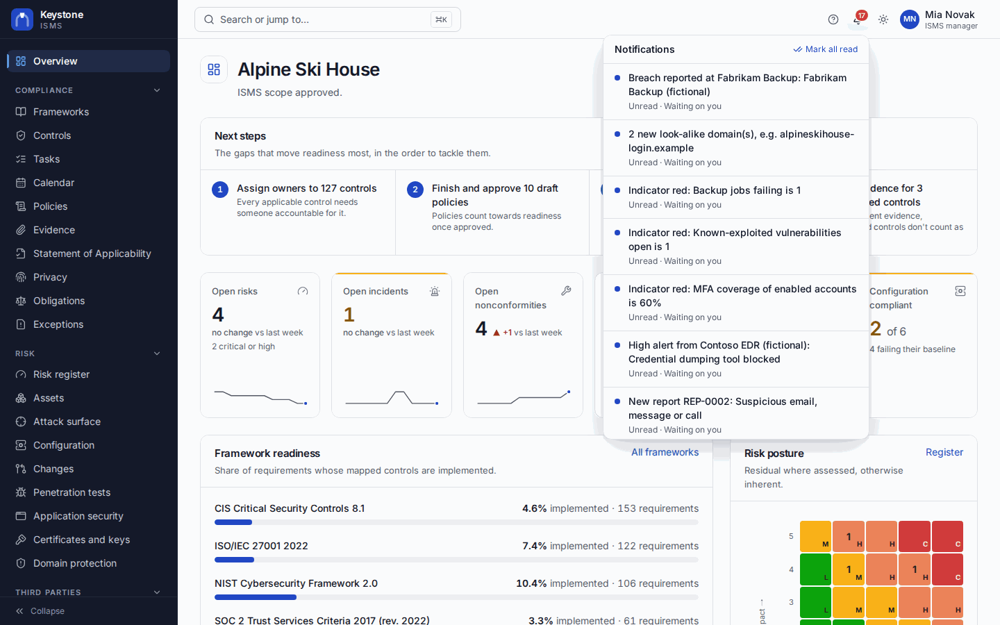

The bell lists what needs **you**: tasks and reviews due within two weeks, approvals waiting for you, policies to
accept, new configuration and attack surface findings on things you own, failed integrations and questionnaires that
came back.

- Items go to the owner of the record: a risk above appetite to its risk owner, expiring evidence to the control
  owner, a vendor's missing data processing agreement to the vendor owner, and so on.
- Approvals and effectiveness checks go to people allowed to approve, never to the person whose work it is.
- Items on records without an owner go to the ISMS managers as one summary line each.
- Choosing an item opens the record and marks it read. **Mark all read** clears the count.
- If email is set up, you also get a **daily digest** of unread items. Choose what it includes under
  **My account → Notifications** (the bell always shows everything).

### Your account

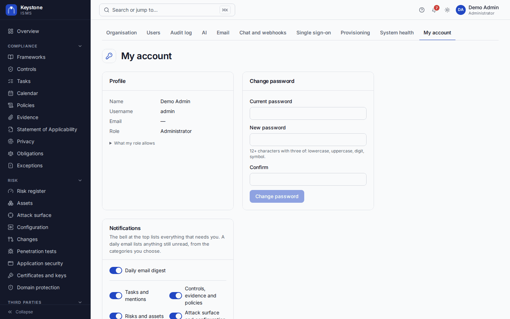

Your name in the top-right corner opens a menu:

- **My account**: your profile, **What my role allows**, password change and notification preferences.
- **My employee portal**: policies to accept, your training and your device checklist (everyone has one).
- **Take the tour**, and **Sign out**.

The sun/moon button next to it switches between light, dark and your system's setting.

### Roles: what you can do

Your administrator gives you one role. Everyone with a staff role can read the ISMS; the role decides what you can
change.

| Role | Can |
|---|---|
| **Administrator** | Everything, including users and roles, single sign-on, email and AI settings |
| **ISMS manager** | Run the ISMS: everything except managing users and the AI settings. Approves policies, accepts risks, verifies corrective actions, manages audits, integrations and the Trust Center |
| **Risk owner** | Assets, risks, evidence, incidents, nonconformities, tasks, business continuity |
| **Control owner** | Controls, evidence, incidents, nonconformities, tasks, customer questionnaires |
| **Auditor** | Read everything, record audit findings, read the audit log. Auditor accounts must have an expiry date |
| **Viewer** | Read everything, comment, accept policies |
| **Employee** | The employee portal only: accept policies, complete training, confirm device security |

Keystone also enforces **segregation of duties**: nobody approves their own policy, task, vendor assessment, DPIA
or exception; the owner of a risk can't accept it, and whoever accepted it can't take it over while the acceptance
stands; neither the owner of a corrective action nor whoever completed it can verify it; whoever answers an auditor's
evidence request can't accept the answer; and internal auditors don't audit controls they own.

---

## 2. Working with records

These work the same way on every register (controls, risks, assets, vendors and so on).

**Tables**

- **Search** filters the rows as you type. Click a column heading to sort.
- **Filters** (for example *All domains*, *Any owner*) narrow the list. On Controls and Tasks the filters are kept in
  the page address, so you can bookmark or share a filtered view, and **Views → Save current filters** keeps it for
  you.
- **Export CSV** downloads what the table shows, with its current search and sort. Cells a spreadsheet would run as
  formulas are made safe.
- **Bulk changes.** Tick rows to change several at once: owner and status for controls, assignee and due date for open
  tasks. If any one change is refused, nothing changes, and every changed record gets its own audit entry.
- Numbers on cards at the top of a page (for example *Reviews overdue*) summarise the register.

**Record panels.** Click a row to open the record in a panel on the right. Most records open read-only; choose
**Edit** to change them, and Keystone asks before discarding unsaved edits. Escape or **×** closes the panel. The
page address changes too, so you can send someone a link straight to the record.

**Discussion and history.** Risks, controls, tasks, incidents, policies, vendors, assets, nonconformities, audits,
privacy and continuity records and configuration targets have a **Discussion**. Type `@` and choose a person to
mention them; they get a notification. Comments can't be edited or deleted. **Show history** lists who changed what
and when, with old and new values, from the audit log.

**Import from CSV.** Assets, Risks, Vendors and People have **Import CSV**.

1. Download the template and fill it in: one row per record, owners by username or email, dates as `YYYY-MM-DD`,
   `yes`/`no` for flags.
2. Choose the file. Keystone checks every row with the same rules as the forms and lists problems by row number.
3. Nothing is saved until every row is valid and you confirm. The import is all or nothing, up to 1,000 rows at a time.

**Deleting.** **Delete** removes a record created by mistake. Keystone refuses while anything depends on the record,
or once anything about it was approved, accepted, signed, notified or verified, and says what to do instead (close,
retire or terminate it). The audit log keeps the deleted record's last values.

**Tickets.** If your organisation connected Jira, ServiceNow, ConnectWise PSA or Autotask, a **Ticket** button on
risks, vulnerabilities, findings, tasks, incidents and nonconformities opens a ticket there and shows when it's closed.

---

## 3. Setting up the ISMS

*For ISMS managers and administrators. The first administrator is created on the setup screen the first time
Keystone is opened.*

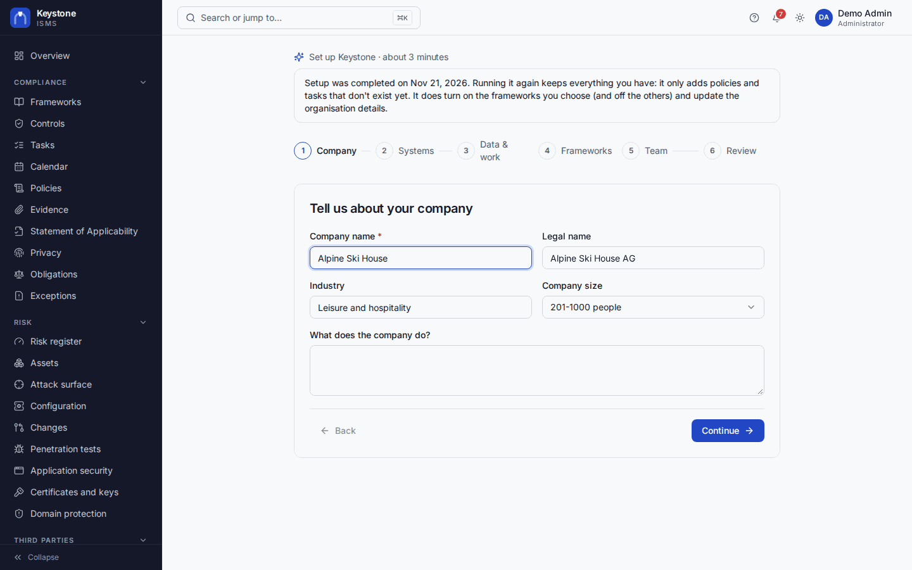

1. **Run the setup wizard** (**Start setup** on the Overview). Describe the company: size, where systems are hosted,
   the data you handle, whether you build software or run offices, and the frameworks you work to. Keystone then:
   - loads the frameworks and writes a first ISMS scope,
   - drafts 16 policies from its templates,
   - schedules recurring evidence tasks,
   - marks controls that clearly don't apply as not applicable, with the reason.

   You can run it again later: it only adds what doesn't exist yet.
2. **Set the context** under **Settings → Organisation**.

   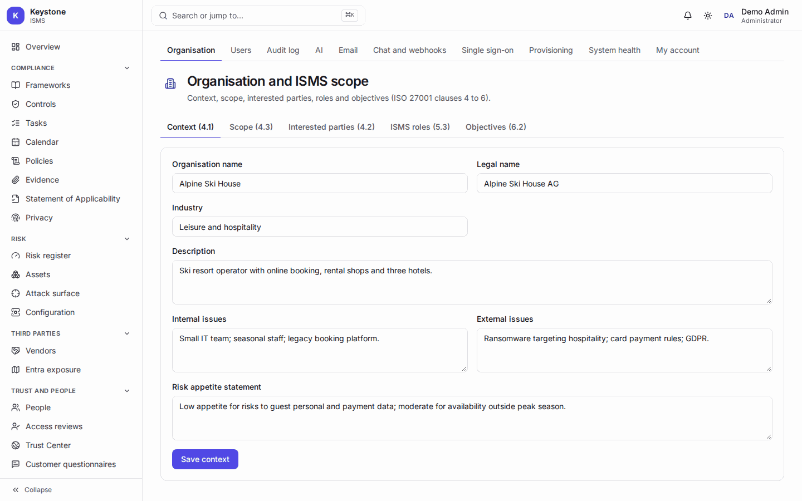

   - *Context (4.1)*: internal and external issues and the risk appetite statement.
   - *Scope (4.3)*: write and **approve** the ISMS scope. Editing it later clears the approval.
   - *Interested parties (4.2)* and *ISMS roles (5.3)*.
   - *Objectives (6.2)*: security objectives with a measure and target. Record measurements over time and see the
     trend, or link an objective to a dashboard figure (for example overdue tasks) so it is measured every day.
3. **Invite people** under **Settings → Users** (staff) and **People** (everyone, for the employee portal).
4. **Review the draft policies**, adapt them and send them for approval (see [Policies](#policies)).
5. **List your assets** and give each an owner (see [Assets](#assets)).
6. **Give controls owners** and work through **Next steps** on the Overview.

---

## 4. Overview

The Overview is the starting point for everyone.

- **Next steps**: up to four gaps worth closing next, worked out from your data: scope not approved, controls without
  an owner, draft policies, approvals waiting, implemented controls without evidence, no integration connected,
  employees with portal tasks open, Trust Center not published. Each opens a filtered list.
- **Headline figures**: open risks, incidents and nonconformities, vendors, controls audited in the last three years
  and, once you check configurations, hosts and firewalls meeting their baselines. Each links to its register and
  shows the change since last week and a 12-week trend; hover the line for a week's value.
- **Framework readiness**: the share of each framework's requirements whose controls are implemented.
- **Risk posture**: the heat map of current risk. Click a cell to see those risks.
- **Needs attention** and **My tasks** further down list what's overdue and what's yours.

---

## 5. Compliance

### Frameworks

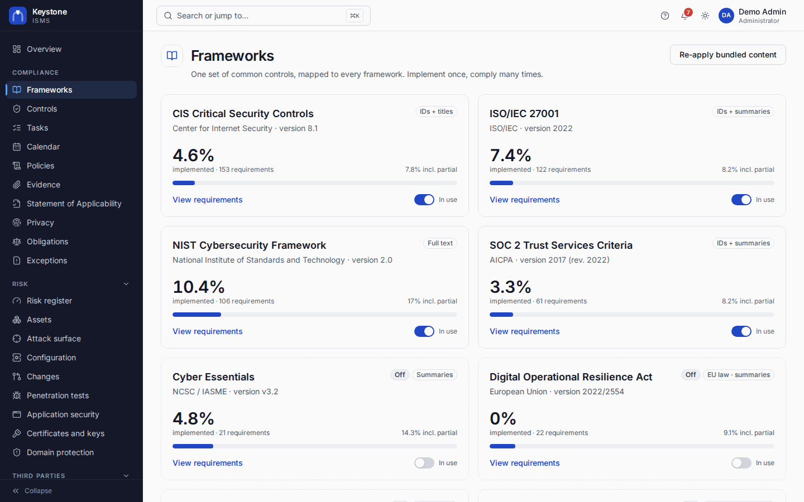

Keystone keeps one set of about 128 **common controls**, each mapped to every framework it supports: ISO/IEC
27001:2022, NIST CSF 2.0, SOC 2, CIS Controls v8.1, NIS2, DORA, GDPR, ISO/IEC 27701, ISO/IEC 42001, PCI DSS 4.0.1,
Cyber Essentials and the Essential Eight. Implement and evidence a control once and it counts towards every framework.

- Turn a framework **In use** to include it in readiness, the Statement of Applicability and the Trust Center.
- **View requirements** lists each requirement with the controls that meet it and their status.

  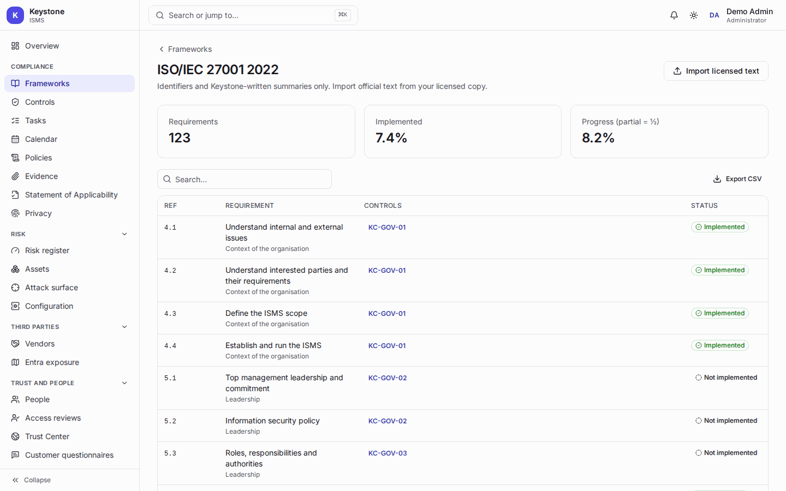
- Framework text in Keystone is identifiers with Keystone-written summaries (licensing). If you hold a licence, import
  the official wording with **Import licensed text**; it is stored only in your database.

### Controls

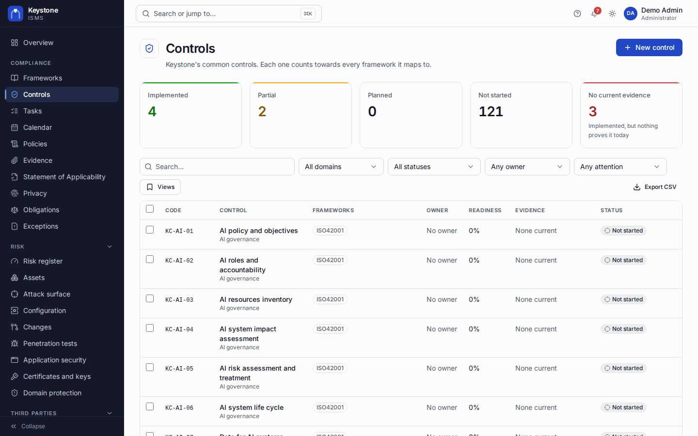

Controls are the measures you put in place. For each one you set an **owner**, a **status** (not started, planned,
partial, implemented, not applicable) and **how it is implemented**.

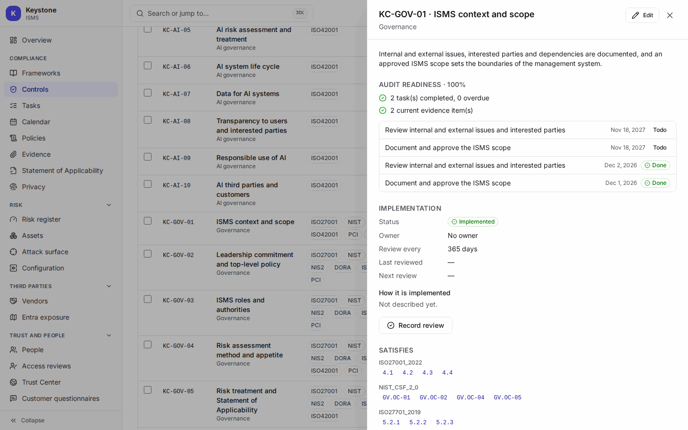

- **Audit readiness** shows whether the control is ready for an audit: tasks done on time, current evidence, passing
  integration checks.
- **Not applicable** needs a reason, and is set one control at a time.
- **Record review** keeps the control's review cycle current.
- **Evidence and tests.** The panel lists current evidence and **control tests**: auditors and ISMS managers record
  design or operating-effectiveness tests with the method, sample, result and the evidence examined. The control owner
  can't test their own control. An ineffective result can raise a nonconformity straight away.
- **Mappings.** *Satisfies* lists the requirements this control meets in each framework. **Map to a requirement** adds
  your own mapping; Keystone's mappings can't be removed. **New control** at the top of the page creates your own control (`KC-CUS-nn`) for
  requirements you meet differently.
- When you give controls a new owner, **Also hand over their open tasks** (on by default) moves their open tasks too.

### Tasks

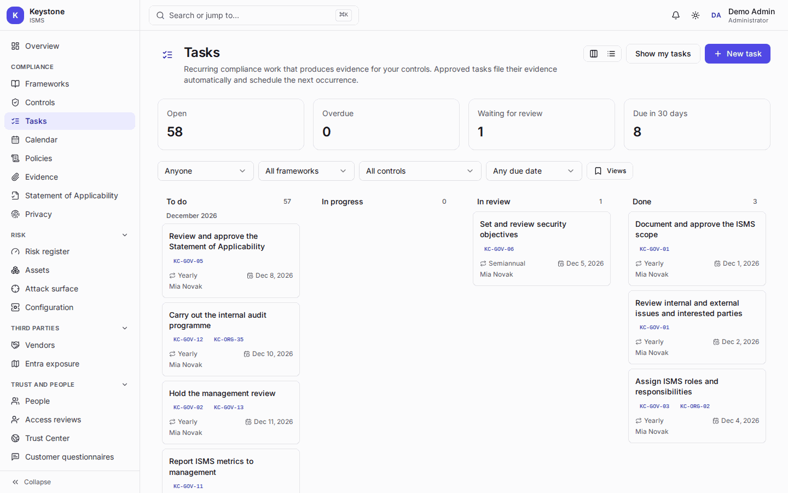

Tasks are the recurring work that produces evidence, such as "review admin accounts" or "test a backup restore". Each
has linked controls, an assignee, a due date and a frequency. The board groups them by status; the list view (the
icon next to the board icon) allows bulk changes. **Show my tasks** filters to yours.

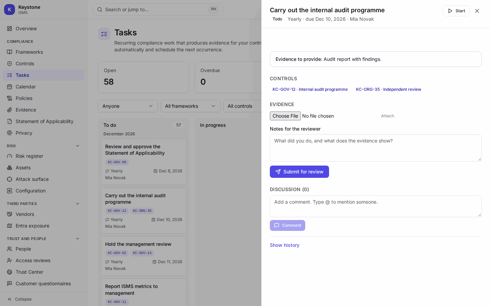

1. Open a task and choose **Start**.
2. Do the work. Add a note and attach files: the panel says what evidence to provide.
3. **Submit for review**. Someone other than the assignee approves it or sends it back.
4. Approving files the note and files as **evidence on every linked control** and schedules the next occurrence.

Overdue tasks make their controls not ready. Tasks follow control owners: reassigning a control's owner can move its
open tasks.

### Calendar

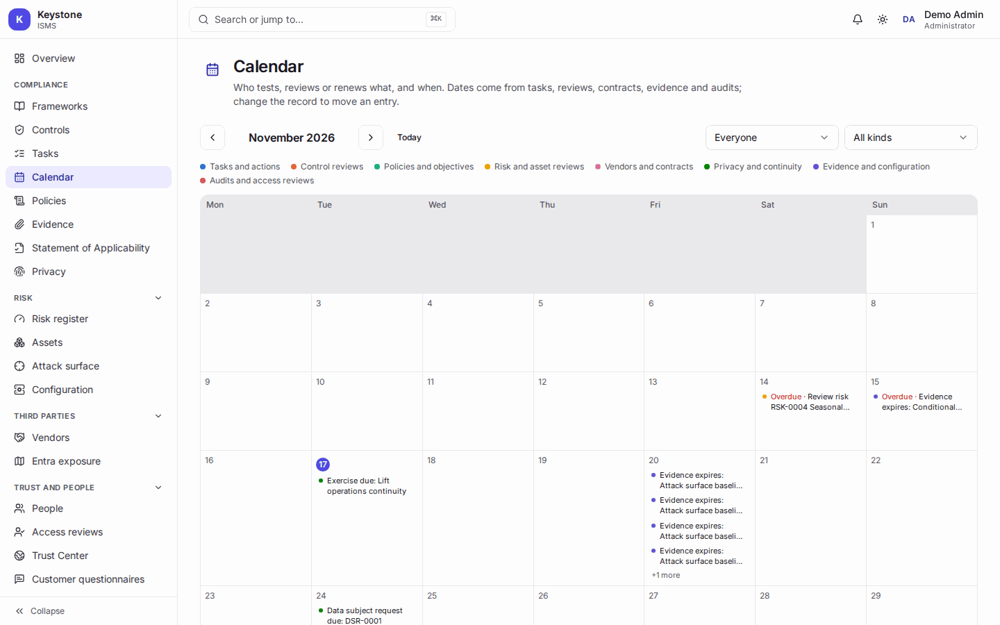

Everything that is due, by date: tasks, control and risk reviews, policy reviews, contract ends, expiring evidence,
audits, data subject request deadlines, DPIA and processing reviews, continuity tests and plan exercises, access
reviews, nonconformity and corrective-action due dates, objective target dates, and when an uploaded firewall
configuration goes out of date. Filter by person or kind. To move an entry, change the record it comes from.

### Policies

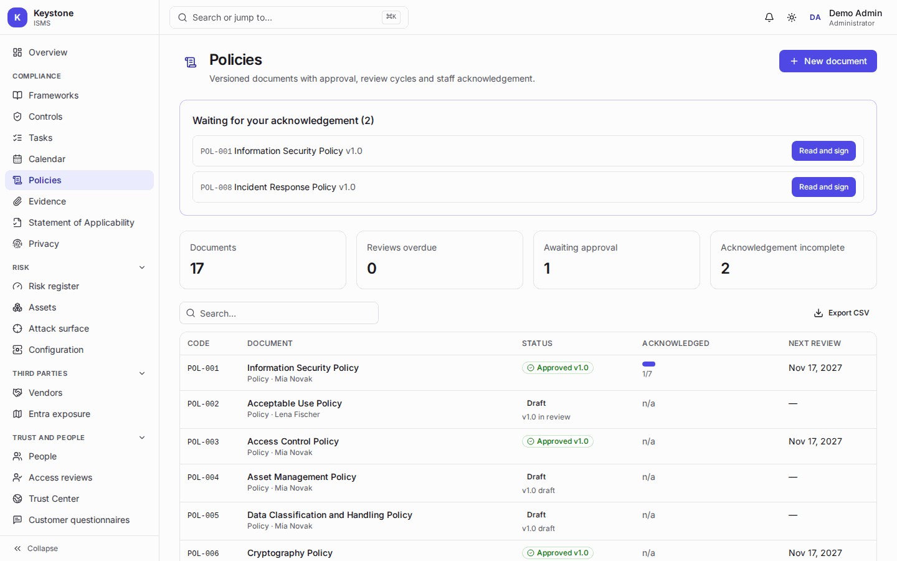

Policies, standards, procedures and plans, each with versions, approval, a review cycle and staff acknowledgement.
Policies waiting for **your** acknowledgement are listed at the top: **Read and sign**.

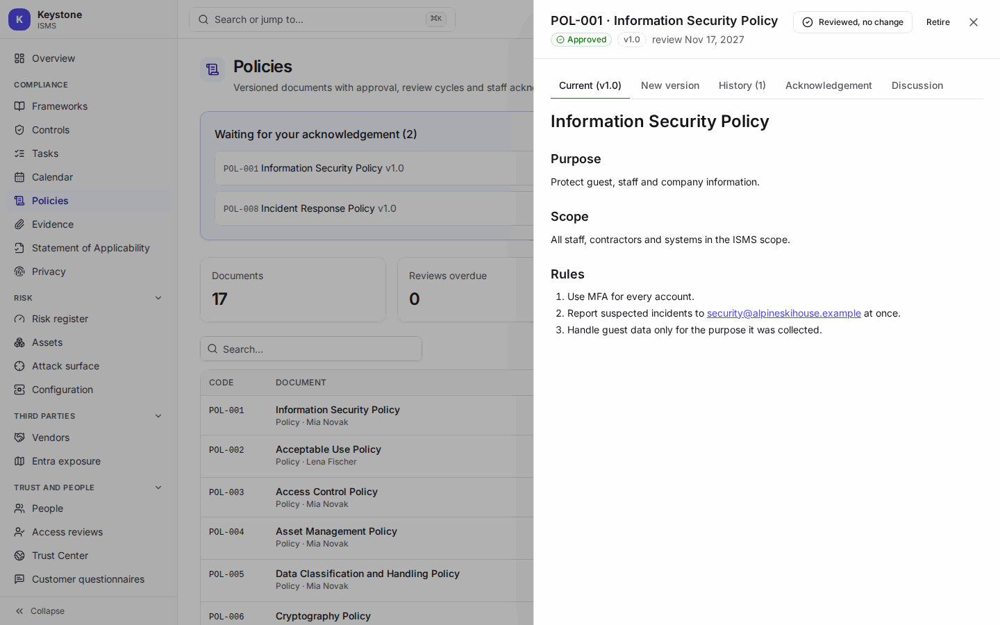

To change a policy:

1. Open it and choose **New version**. Leave **Major version** ticked when people must accept it again (2.0); untick
   it for a minor change (1.1) that keeps earlier acknowledgements. Write the text in the editor (Markdown) or attach
   a file.
2. **Submit for approval**. An approver who isn't the author approves it or returns it with a reason.
3. Approving publishes the version, sets the next review date and, if acknowledgement is required, asks the people in
   its audience to accept it.

Good to know:

- **Electronic signatures.** Approving and accepting are signed by typing your full name as Keystone knows it.
  Keystone records the name and time (and, for acknowledgements, the IP address and browser) with a SHA-256
  fingerprint of the exact version.
- **Acknowledgement** tab: limit who must accept the policy to departments or employment types, and see who has.
- **History → Compare** shows what changed between a version and the one before it. **PDF** downloads any version
  with its approval and fingerprint; **PDF + signatures** adds the acknowledgement register.
- **Reviewed, no change** records a periodic review without a new version.
- **AI assist** (when an administrator turned AI on): describe the change, for example "add a section on privileged
  access". Claude proposes a revision as a diff with points to check. Accepting it creates a draft that still goes
  through approval.

### Evidence

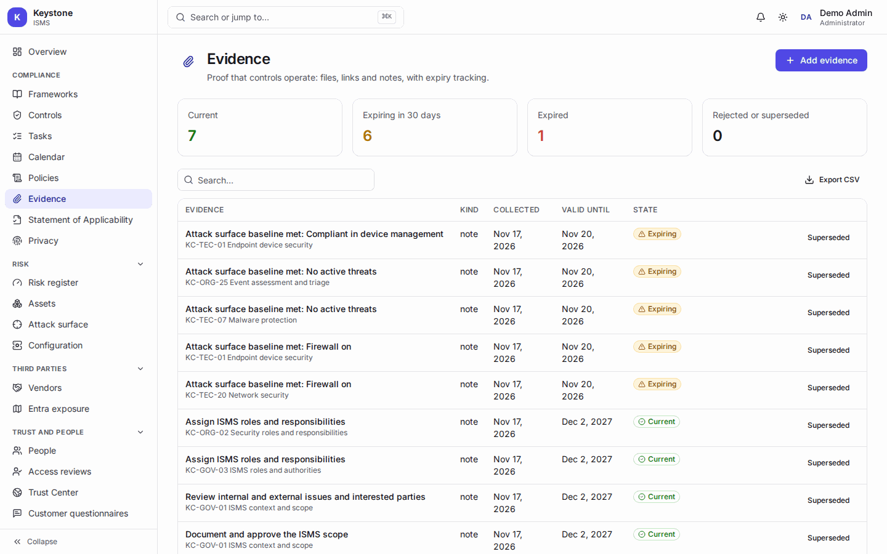

Evidence shows that controls operate: files, links or notes, each with a **valid until** date.

- **Add evidence**, choose the controls it supports (one item can support several controls) and set how long it's
  valid. Approved tasks and passing integration checks add evidence by themselves.
- Keystone warns 30 days before evidence expires and lists implemented controls without current evidence.
- **Accept** or **Reject** evidence: someone other than the person who added it decides. Rejected evidence shows the
  reason and no longer counts.
- The eye icon opens PDFs, images and text files in Keystone's viewer.

### Statement of Applicability

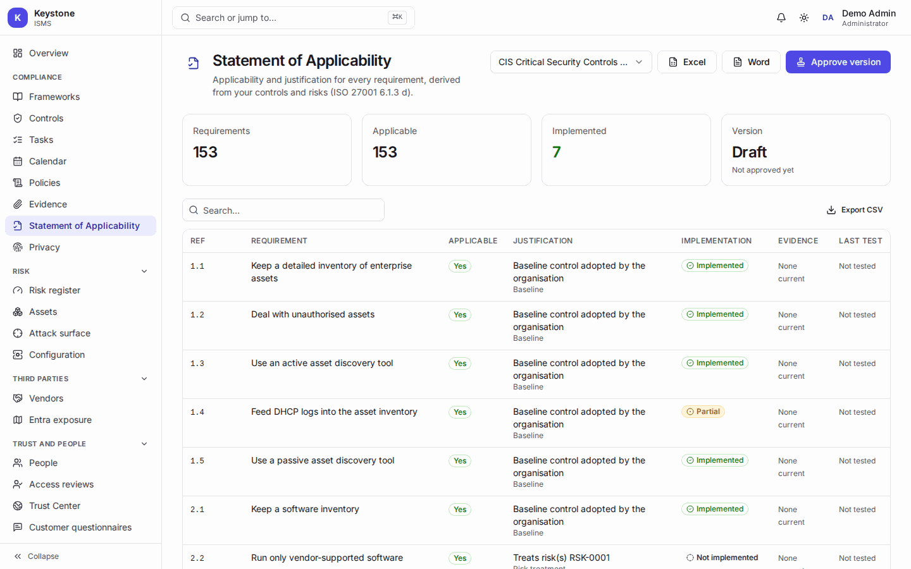

The Statement of Applicability (SoA, ISO 27001 6.1.3 d) is built for each framework from your controls and risks:
whether each requirement applies and why, its implementation, current evidence and latest test.

1. Choose the framework at the top.
2. Override a requirement's applicability by recording a decision with a justification.
3. When it's ready, **Approve version**. Keystone shows what changed since the last approved version.
4. Export to **Excel** or **Word** for your auditor.

### Privacy

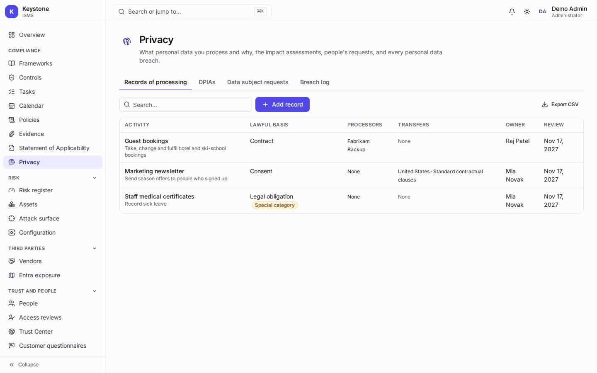

Four registers for data protection (GDPR):

- **Records of processing** (Article 30): each activity's purpose, lawful basis, people and data, processors (from the
  vendor register), systems (from the asset register), transfers outside the EEA and their safeguard, and retention.
  Keystone refuses a legitimate-interest record without the interest, special category data without an Article 9
  condition, and transfers without a safeguard.
- **DPIAs** (Article 35): describe the processing and why it's necessary, list risks to people with likelihood,
  severity, measures and residual risk, record the DPO's advice, and submit. Someone with risk-acceptance rights who
  didn't write it decides. A high residual risk is flagged: the supervisory authority must be consulted first.
- **Data subject requests**, visible only to people who handle privacy:

  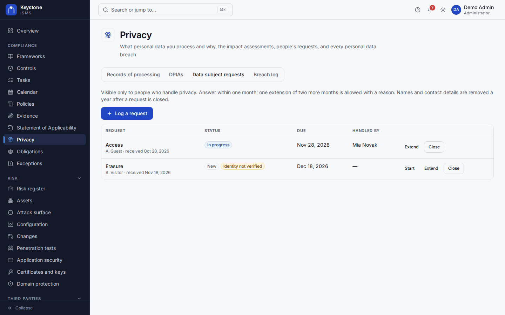

  1. **Log a request** with its type and the date it was received. It is due one month later.
  2. Verify the requester's identity before you **Start**.
  3. **Extend** once, by up to two more months, with a reason.
  4. **Close** it with a note of what was done or why it was refused.

  Names and contact details are removed a year after closing and never appear in the audit log.
- **Breach log**: every incident involving personal data, with its 72-hour deadline and an assessment of the data,
  people affected, consequences, measures and risk to people, including why it was or wasn't notified.

### Legal and contract obligations

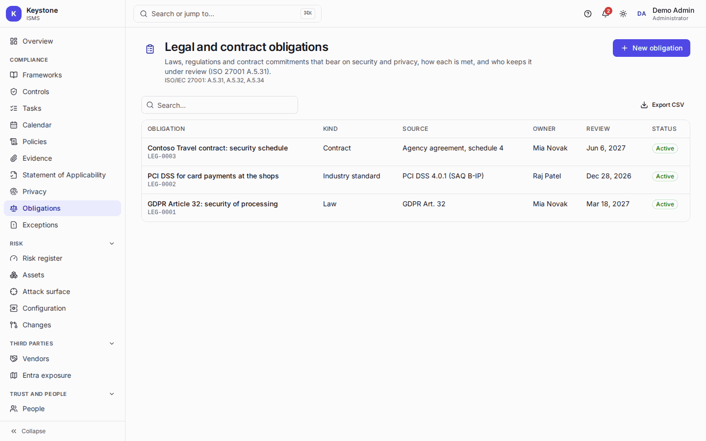

**Compliance → Obligations** lists the laws, regulations, industry standards and contract commitments that bear on
security and privacy (ISO 27001 A.5.31): for example GDPR Article 32, PCI DSS for card payments, or the security
schedule of a customer contract. For each one, record what it requires, how you meet it, the controls that meet it
and an owner; the next review date goes on the calendar. **No longer applies** retires one with a note.

### Exceptions

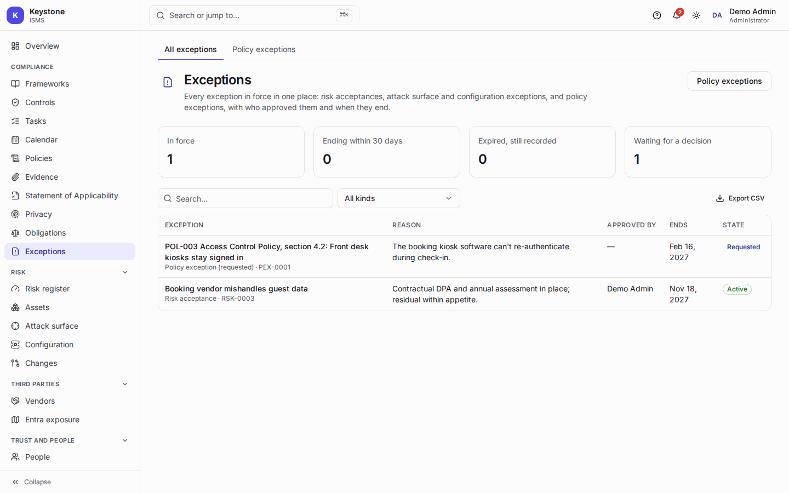

**Compliance → Exceptions** lists every exception in force, wherever it was granted: risk acceptances, attack surface
and configuration exceptions, and policy exceptions. Each shows the reason, who approved it and when it ends; ones
that ended or end within 30 days are at the top.

**Policy exceptions** (the second tab) are approved departures from a policy:

1. **New policy exception**: the policy and section, who or what it covers, why it's needed, and an end date at most
   a year ahead.
2. Add the **compensating controls** that reduce the risk meanwhile.
3. Someone with risk-acceptance rights who didn't raise it **approves** or **rejects** it (with a reason). **End now**
   ends it early.

---

## 6. Risk

### Risk register

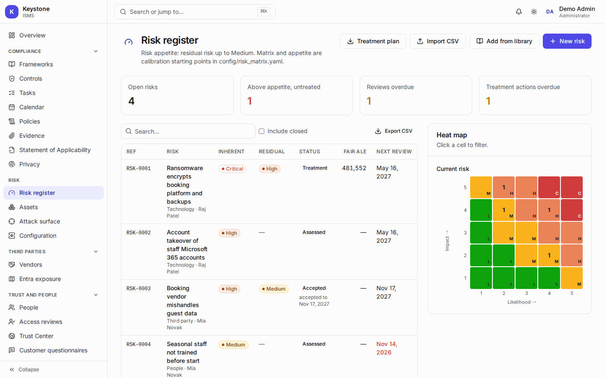

The risk register (ISO 27001 6.1.2 and 8.2) records each risk with its threat, vulnerability and consequence, and rates
it twice: **inherent** (before controls) and **residual** (with controls), as likelihood × impact on the risk matrix.
The heat map shows current risk; click a cell to filter. Risks above the **risk appetite** shown in the header are
flagged.

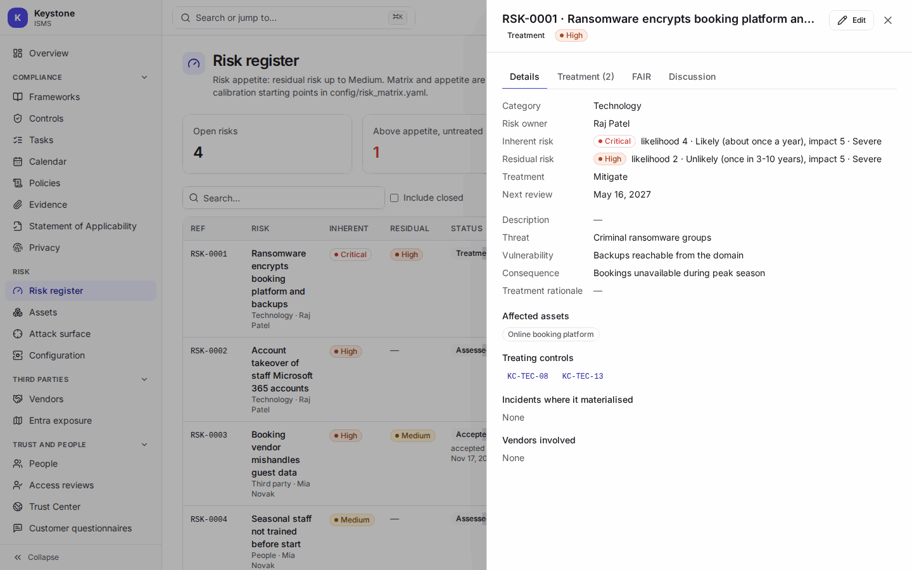

To add and treat a risk:

1. **New risk**, or **Add from library** to start from one of 24 common scenarios with a suggested rating and treating
   controls, which you then adjust.
2. Rate inherent and residual likelihood and impact, and link the affected assets.
3. Choose a **treatment**: mitigate, accept, transfer or avoid. Link the controls that treat it, and add **treatment
   actions** with owners and due dates (*Treatment* tab).
4. **Accepting** a risk needs risk-acceptance rights and a justification; the approver can't be the risk owner, and
   can't take the risk over while the acceptance stands. Risks above appetite can be accepted for at most a year. If
   the risk's rating later rises above the level that was accepted, the acceptance lapses and the risk needs a new
   decision.

Good to know:

- **FAIR** tab: enter ranges (minimum, most likely, maximum) for threat event frequency, threat capability, control
  strength and loss magnitude, then run the simulation for an expected annual loss, percentiles and a loss exceedance
  curve. Results support decisions; they are not predictions.
- The panel shows **incidents where the risk materialised** and **vendors involved**. Linking an incident brings the
  risk's review forward.
- **Treatment plan** downloads the risk treatment plan (6.1.3 e): each open risk with its owner, levels, treatment and
  controls, one row per action, plus acceptance and next review.
- Review dates follow the risk level. The matrix, appetite and review intervals are set by your administrator.

### Assets

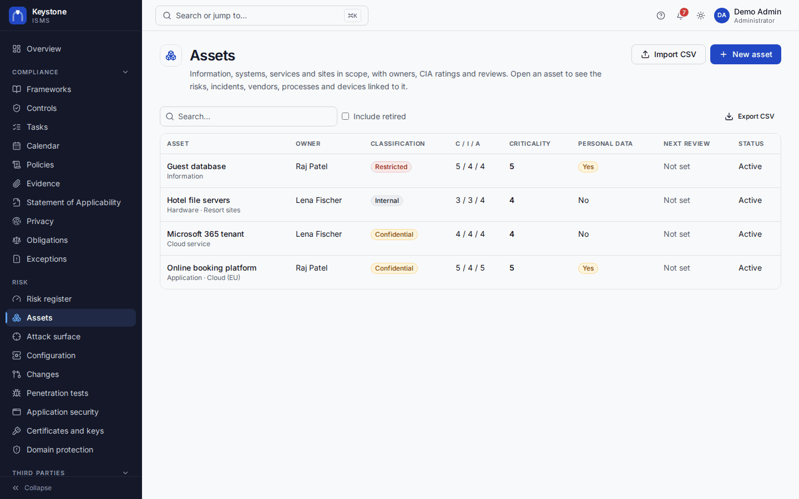

The asset register (ISO 27001 A.5.9) lists the information, systems, services and sites in scope, each with an
owner, a classification, confidentiality/integrity/availability ratings and whether it holds personal data.

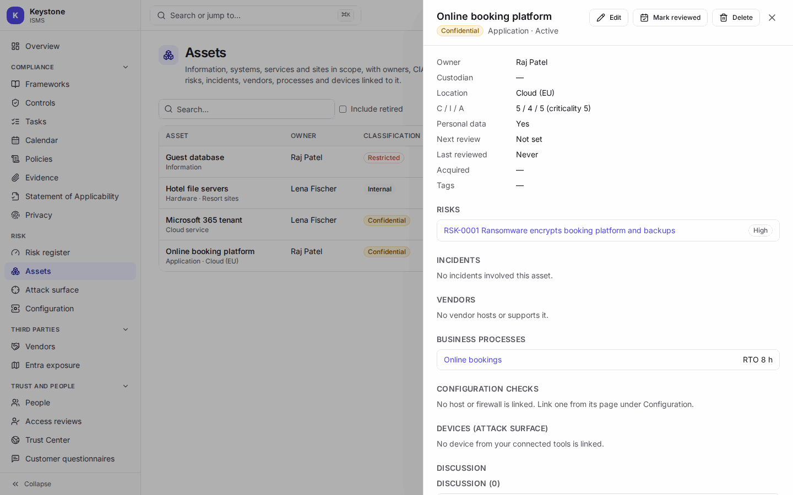

Open an asset to see everything linked to it: risks, incidents, vendors that host or support it, business processes
that depend on it, configuration checks on it, and devices your attack surface tools report (with suggested matches
to link). The panel also has:

- **Mark reviewed**, which sets the next review a year on. Owners are reminded two weeks before.
- Acquisition and disposal dates, tags and a discussion.

When someone is offboarded, their People page lists the assets they own so they can be returned or reassigned.

### Attack surface

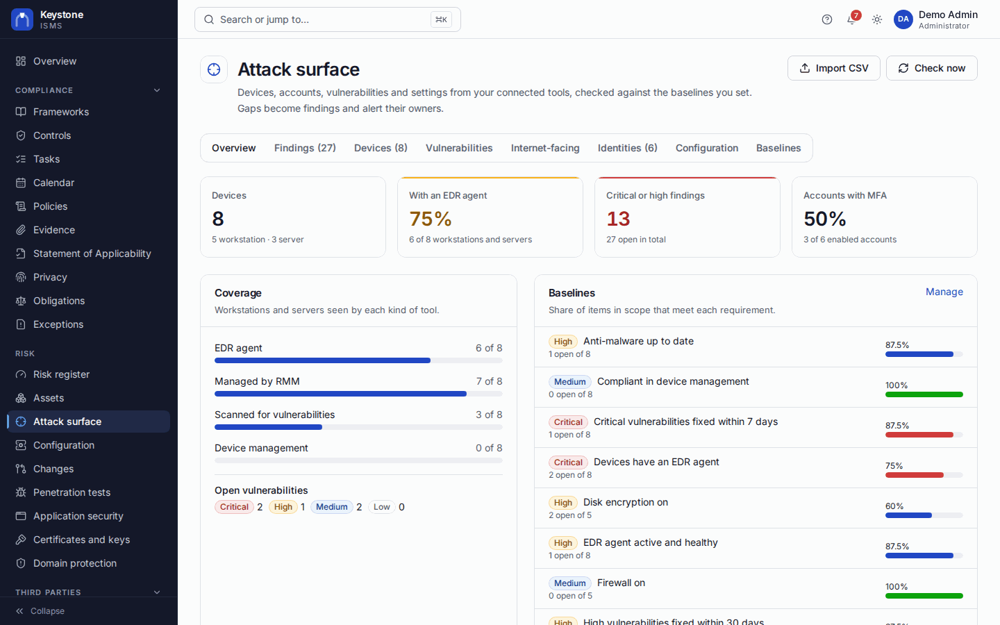

**Attack surface** brings together what your security tools report (devices, accounts, vulnerabilities and tenant
settings) and checks it against **baselines** you set, such as *Disk encryption on*, *MFA registered for every enabled
account* or *Critical vulnerabilities fixed within 7 days*.

- **Overview**: coverage per tool and how well each baseline is met. A device the RMM manages but no EDR agent reports
  is a gap too.
- **Findings** lists the gaps. They open and close by themselves as the tools report changes. New critical and high
  findings notify the device or account owner.
- **Vulnerabilities** are put in fix order: known exploited (CISA KEV) first, then likely to be exploited (FIRST
  EPSS), then by severity, each with a fix-by date.

  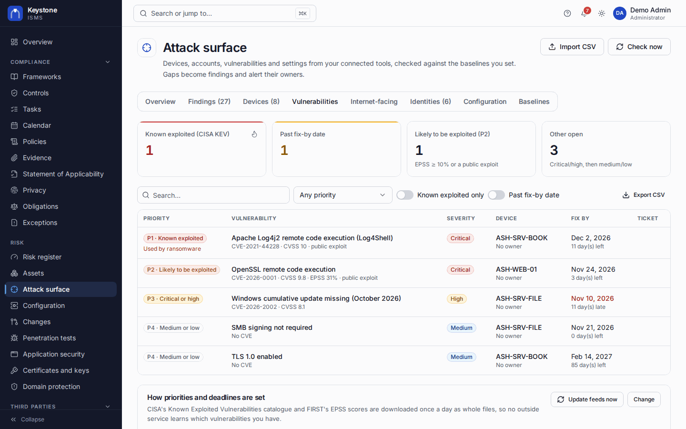
- **Internet-facing**: domains you prove you own (a DNS TXT record) are checked passively every day: SPF, DMARC and
  CAA, certificate transparency, dangling DNS records and HTTPS settings. No port scanning.
- **Baselines**: start with **Add recommended baselines**, then adjust scope, severity and linked controls.
- **Exceptions**: to accept a gap for a while, someone with risk-acceptance rights approves an exception with a reason
  and an end date within a year. Nobody can approve one for their own device.

Data a tool doesn't report shows as *no data*, never as compliant.

### Configuration

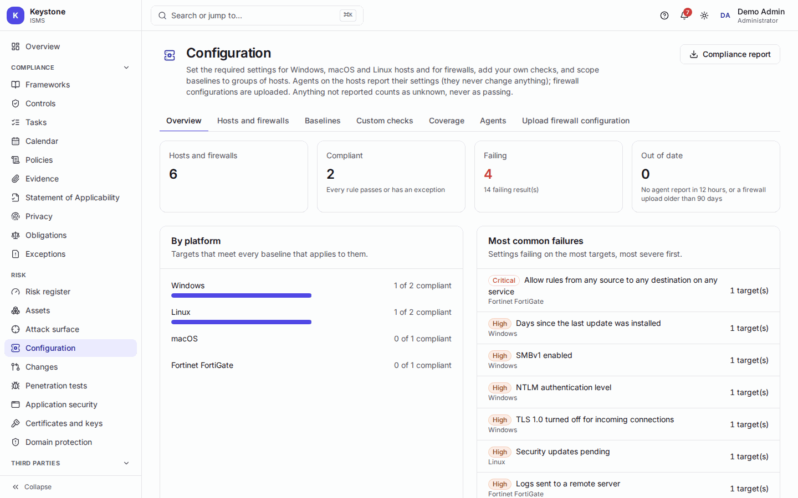

**Configuration** (ISO 27001 A.8.9) checks that Windows and Linux hosts and your firewalls (FortiGate, PAN-OS, Cisco
ASA/IOS, pfSense/OPNsense) are set up the way your **baselines** require. The **Overview** shows compliance per
platform and the most common failures.

**Hosts and firewalls** lists each target with the baselines that apply to it and its results.

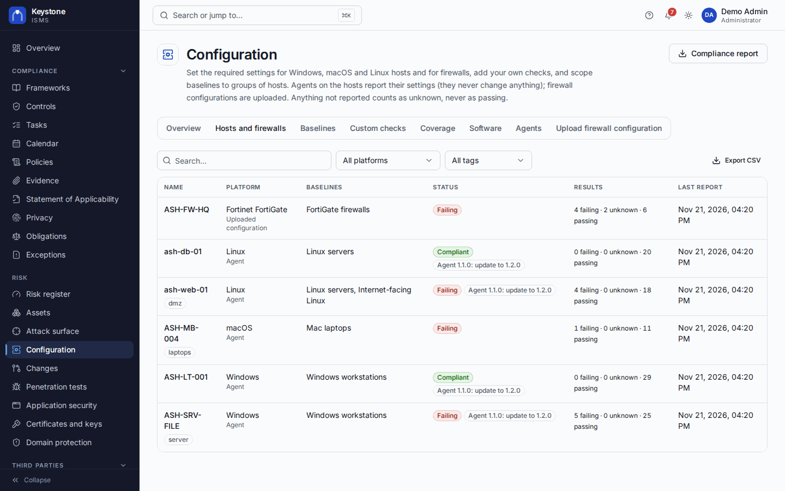

Open one to see every rule's result, with *How to fix* on failing ones, the reported values and the history of what
changed. You can also set its **tags**, pin a baseline, or link it to an **asset**.

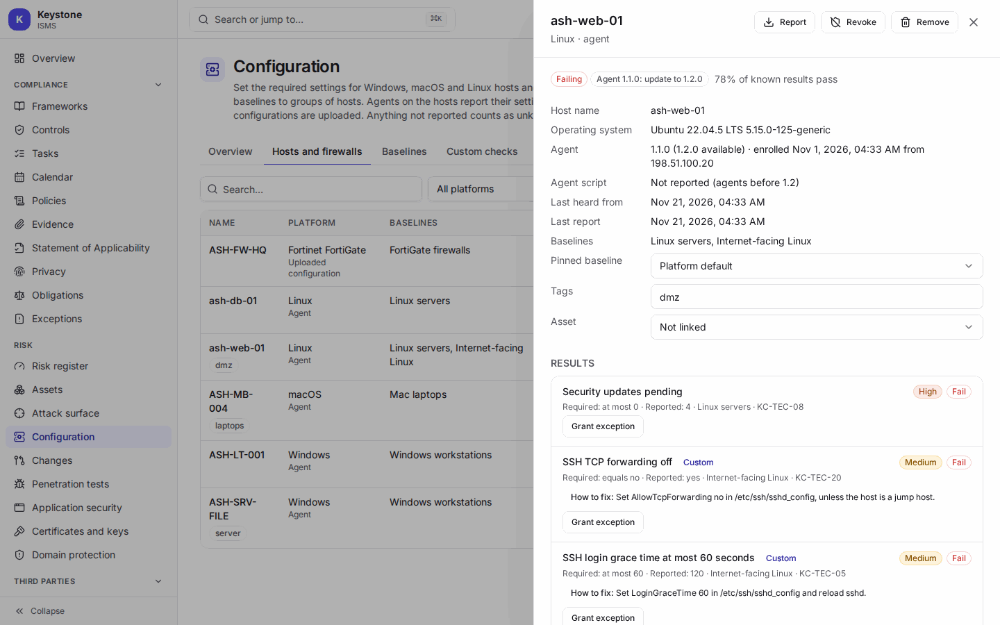

| Result | Meaning |
|---|---|
| **Pass** / **Fail** | The reported value meets or misses the rule |
| **Unknown** | The setting wasn't reported. Never counted as passing |
| **Not applicable** | A prerequisite is off, for example SSH rules on a host without an SSH server |
| **Exception** | A failing rule accepted until a date |

**Baselines** hold the required settings per platform.

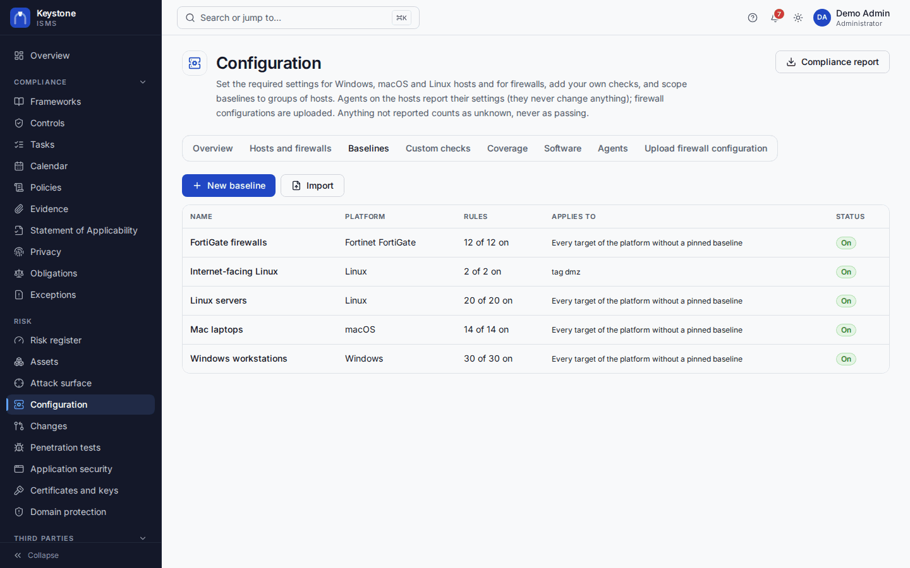

- **New baseline** starts with Keystone's recommended settings for the platform. The first baseline of a platform is
  its **default**: it applies to every host of that platform.
- Open a baseline to change values, severities and linked controls, turn rules off, **Add a rule**, or **Reset** a rule
  to its recommended value.

  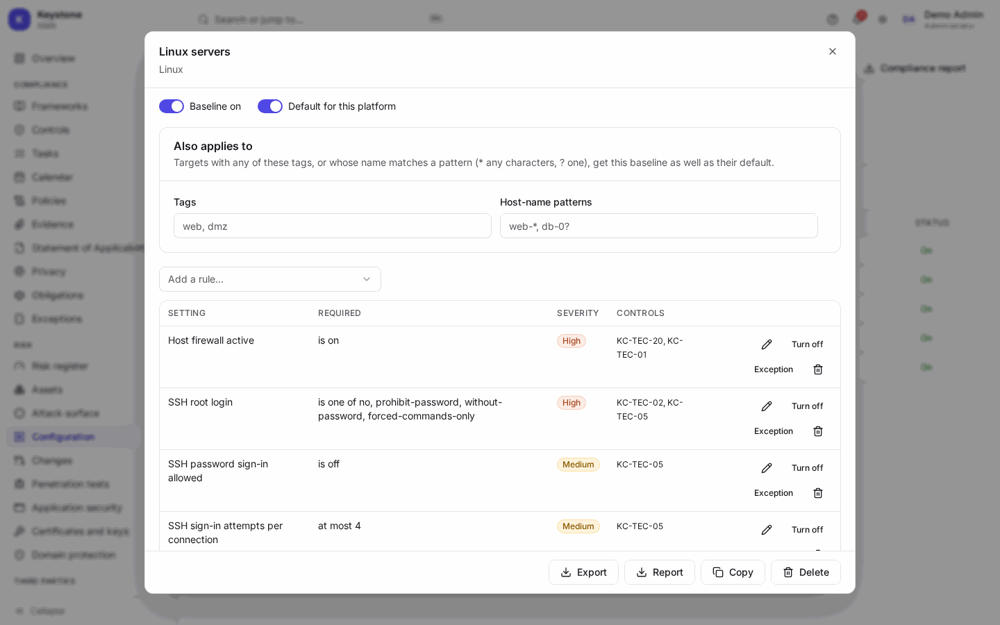
- **Also applies to**: give a baseline tags (for example `dmz`) or host-name patterns (`web-*`) and it applies to those
  targets as well as their default. A single rule can also be limited to tags.
- **Copy**, **Export** and **Import** baselines as JSON, for example to move them between Keystone installations.
- **Exception** on a rule grants it on every target where it fails, with a reason and an end date (risk-acceptance
  rights needed).

**Custom checks** read one more setting each, for when the built-in catalogue doesn't cover something.

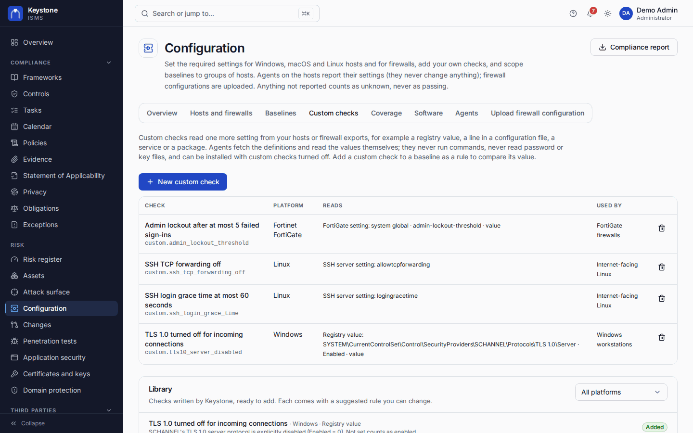

1. Choose **Add** on a check from the **Library** (about 30 written by Keystone), or **New custom check**.

   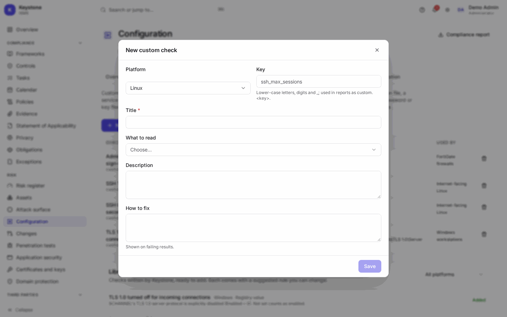
2. Pick the platform, a key, a title and **what to read**: a registry value, a service, an installed package, a file
   setting or permission, a sysctl, an audit or security policy, or a firewall setting. Only literal values are
   compared; there are no scripts or commands.
3. Add it to a baseline as a rule (open the baseline → **Add a rule**).

Agents fetch the definitions and read the values themselves. They refuse to read password and key files, and a host
can be installed with custom checks turned off. Firewalls are checked when their configuration is uploaded, so upload
again after adding firewall checks.

**Agents** (for administrators) shows the one-line commands to install the report-only agents on Windows and Linux.
They read settings every few hours and never change anything on the host.

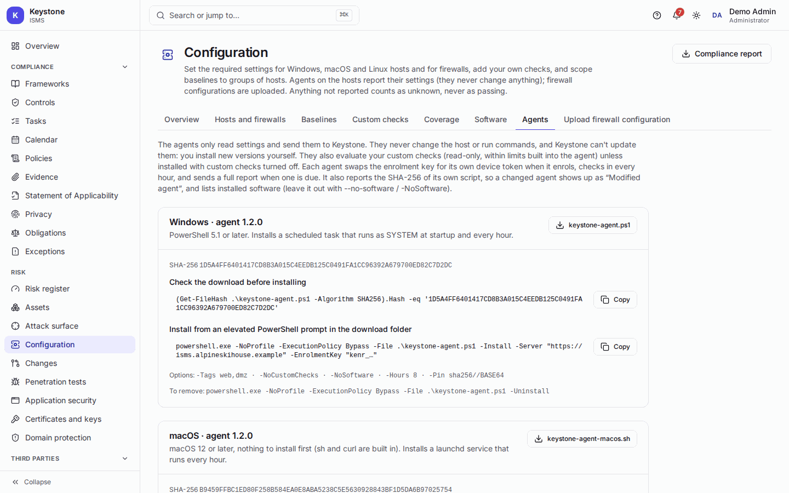

**Upload firewall configuration** checks a configuration export. Keystone keeps only the values it checks and the
file's SHA-256, never the file, because exports contain password hashes and keys.

**Compliance report** downloads every result as a spreadsheet; it's also on each host's and baseline's page.

### Changes

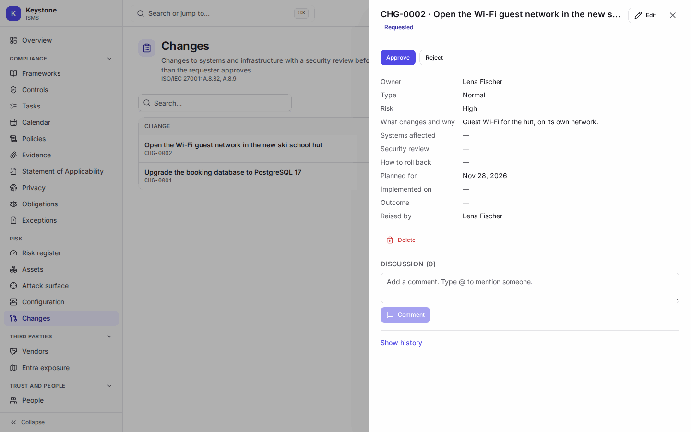

**Risk → Changes** records changes to systems and infrastructure with a security review before they're approved
(ISO 27001 A.8.32).

1. **New change**: what changes and why, the type (standard, normal or emergency), the risk and the systems affected.
2. Before approval, fill in the **security review** (effect on access, exposure, data and logging) and **how to roll
   back**.
3. Someone other than the requester **approves** or **rejects** it. Whoever raised it sees a note instead of the
   buttons.
4. **Mark implemented** records the date; **Close** needs the outcome, including any problems.

---

## 7. Third parties

### Vendors

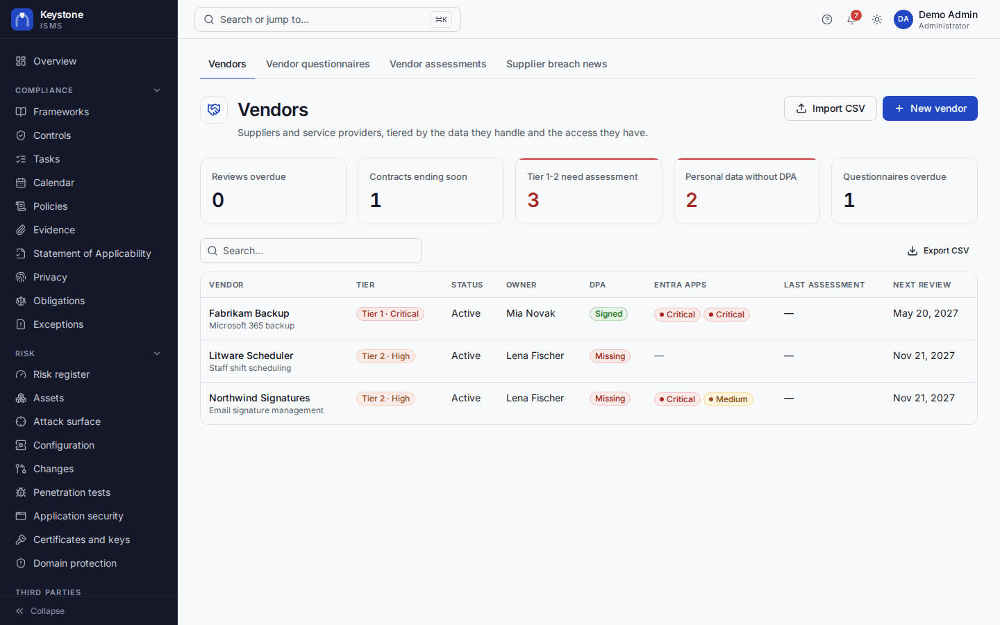

The vendor register (ISO 27001 A.5.19 to A.5.22) lists suppliers and service providers. Each vendor's **tier** comes
from the most sensitive data it handles, its operational criticality, its access to your systems and whether it
processes personal data. Overriding the tier needs a reason.

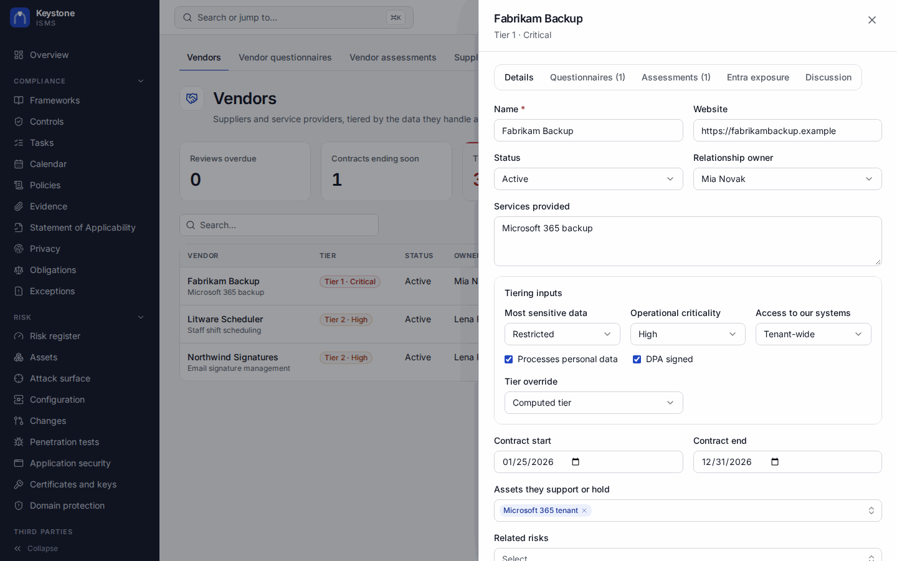

- Record the contract dates, the data processing agreement (DPA), the assets the vendor supports or holds and related
  risks. Reviews come round according to the tier.
- **Offboarding**: setting a vendor to offboarding shows a checklist: access removed, data returned or deleted,
  equipment returned, DPA closed, subprocessor lists and the Trust Center updated, dependent risks reviewed. The vendor
  can't be set to terminated until every item is done, and a vendor that has been active can't go back to
  prospective.

### Vendor questionnaires

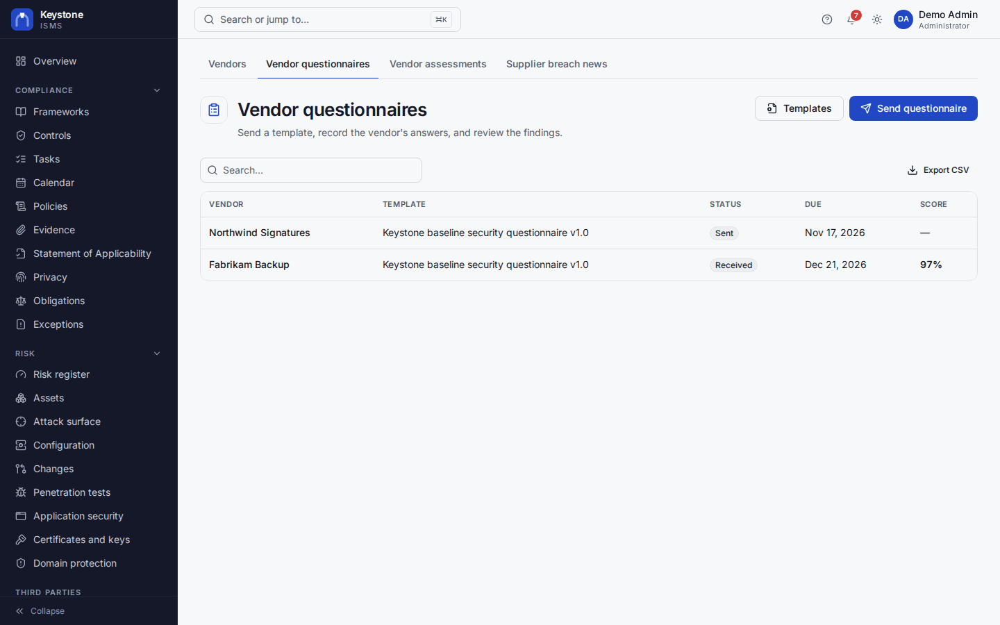

1. **Send questionnaire**: choose the vendor, a template and a due date.
2. Enter the contact and choose **Email link to the contact** (or **Create vendor link** to copy it yourself). The
   vendor answers in the **vendor portal** and uploads supporting documents (PDF, PNG, JPG, DOCX or XLSX, up to 10 MB
   each). Every file is virus-scanned.
3. You can also enter answers yourself as they arrive.
4. **Review** the completed questionnaire. "No" and "partial" answers become findings linked to controls, and the
   score is weighted by question.

**Templates** lets you write your own questions with sections, answer types, weights and the controls they evidence.
A template that has been sent keeps its questions: change it by saving a new version. Owners are reminded of overdue
questionnaires; to chase the vendor, send a new link (it replaces the old one).

### Vendor assessments

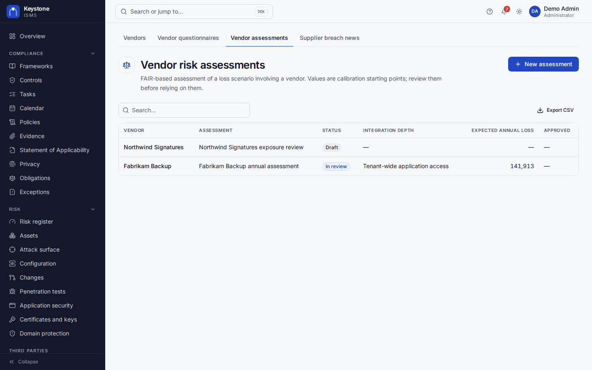

A vendor assessment is a FAIR analysis of a loss scenario involving a vendor. Enter ranges for frequency and loss,
run it for an expected annual loss, and **Submit** it. Someone other than the author approves it. Assessments of
vendors with Microsoft 365 access can take suggestions from Entra exposure (below).

### Entra exposure

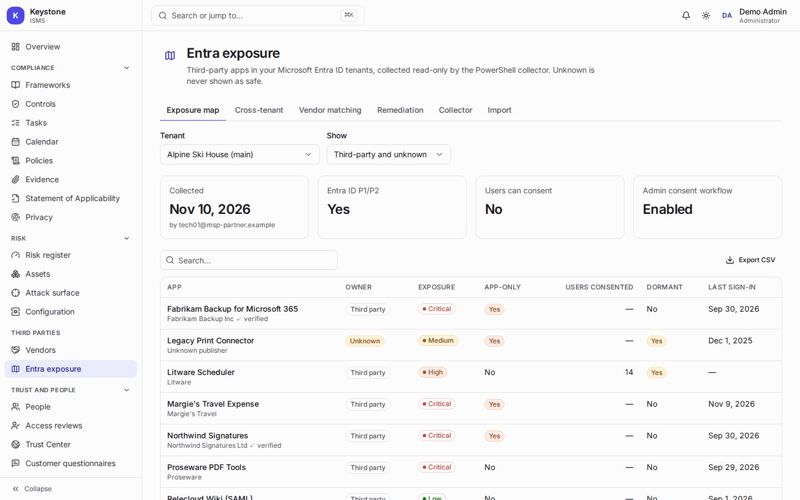

Shows the third-party apps that have access to your Microsoft Entra ID tenants, from a read-only collector a
technician runs.

1. **Collector**: copy the command, run it, and **Import** the `collected.json` it produces. Red banners mean an
   endpoint failed: results that depend on it are shown as unknown, never as safe.
2. **Exposure map**: every third-party app with its exposure level and the reasons for it, its permissions,
   credentials and last sign-in, and changes since the last snapshot.
3. **Vendor matching**: confirm which vendor owns each app publisher. One confirmation applies to every tenant.
4. On a **vendor assessment**, scope it to a tenant and generate suggestions (integration depth, loss ranges, control
   strength). Nothing changes until you accept them.
5. **Remediation**: dormant high-risk apps, unverified publishers with user consent, expired credentials and tenants
   where users can consent. Export them for your Entra administrators.

---

## 8. Trust and people

### People and training

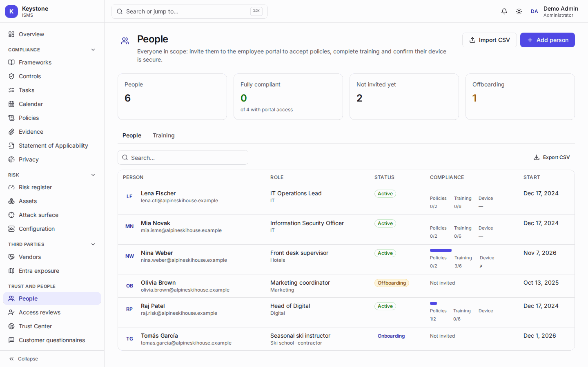

**People** lists everyone in scope, including people without a Keystone staff account, and how far each has got with
policies, training and device checks.

- **Add person**, then **Email invitation** (when email is set up) or **Create invitation link** to send yourself.
  The link gives them access to the employee portal.
- **Offboarding**: when someone leaves, work through the checklist on their page (access removed, assets returned and
  so on). Completing it disables their account.
- **Import CSV** adds many people at once. HR systems (BambooHR, Personio, HiBob) can keep People up to date.

### Security training

**People → Training** is where you manage security awareness training (ISO 27001 A.6.3): which modules there are, who
takes them, how soon, and training people did elsewhere. Changing it needs the people-management permission
(administrators and ISMS managers).

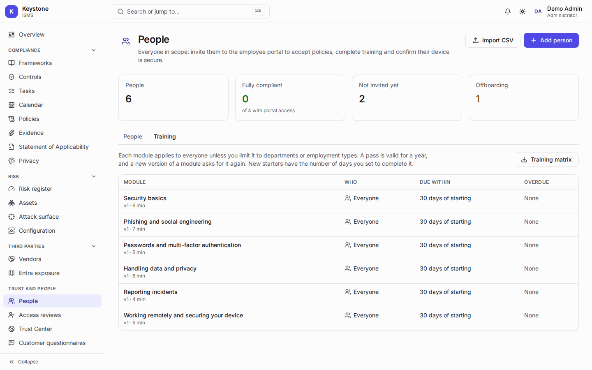

**Modules.** Keystone comes with six built-in modules (*Built-in*). Add your own (*Your own*) for anything specific to
your organisation.

- **Who and when**: click a module's row. Each module applies to everyone unless you limit it to departments or
  employment types, and you set how many days new starters have to complete it.
- **On / off**: the switch. A module that's off isn't offered in the portal, isn't due and isn't in the training
  matrix. Earlier passes are kept.
- A pass is valid for a year. People who are overdue show in the *Overdue* column, and whoever manages people is
  reminded.
- **Training matrix** downloads everyone's status as a spreadsheet, including people without a portal account and
  training done elsewhere.

**Writing your own module.** Choose **New module**.

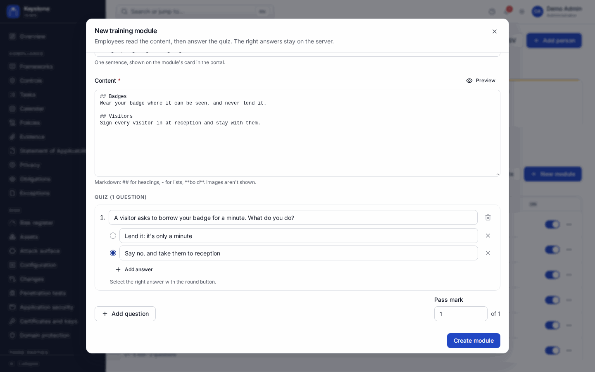

1. Give it a title, a one-line summary and how many minutes it takes.
2. Write the content in Markdown (`##` headings, `-` lists, `**bold**`). **Preview** shows how employees will see it.
3. Write the quiz: up to 20 questions, each with 2 to 6 answers. Select the right answer with the round button. The
   right answers stay on the server; employees never see them.
4. Set the **pass mark** (how many questions must be right), then **Create module**. It's switched on for everyone
   straight away; limit it with *Who and when* if needed.

To change it later, use the module's **⋯** menu → **Edit content and quiz**. Corrections keep everyone's passes. Tick
**New version: everyone takes it again** when the change matters: earlier passes stop counting and the module is due
again. **Delete** works only until someone has taken the module; after that, switch it off instead, because passes
are training records.

**Changing a built-in module.** Built-in modules can't be edited. In the **⋯** menu, **View content** shows them,
and **Make your own copy** creates an editable copy with the same content, quiz, audience and due days, and switches
the built-in module off. Passes of the built-in module count for the copy until you save a new version of it.

**Training done elsewhere.** For a classroom session, an external course or anything else outside Keystone, choose
**Record training**.

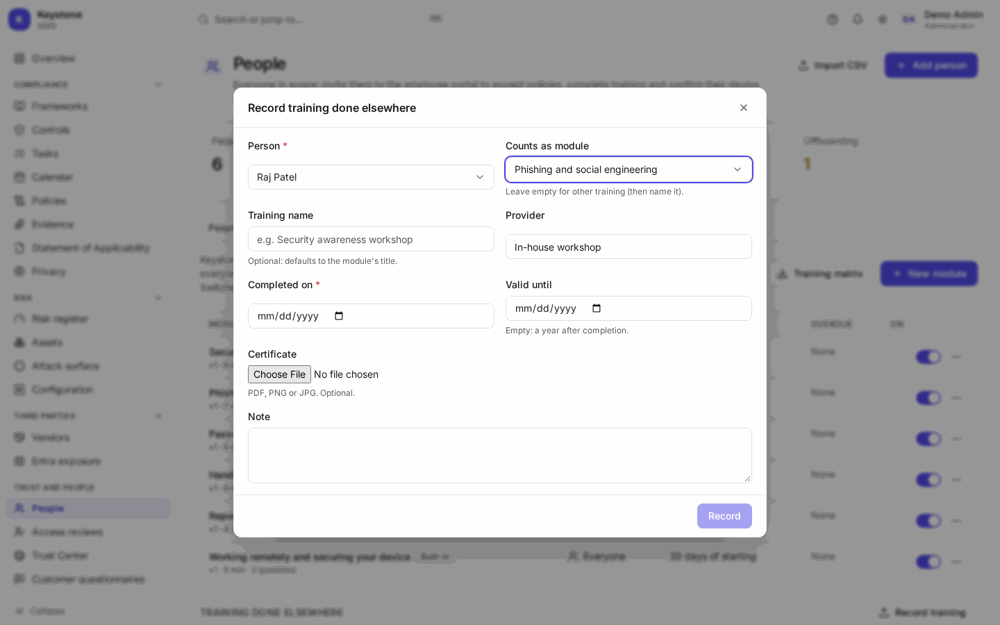

- Choose the person (anyone in People, with or without a portal account) and, if it covers one of the modules, the
  module under **Counts as module**. It then counts as passing that module until **Valid until** (a year after
  completion unless you set another date). Leave the module empty for other training, and name it.
- Attach the certificate if there is one (PDF, PNG or JPG). Certificates are personal data: only people who manage
  people can open them.
- Remove a record entered by mistake with its bin icon; the audit log keeps what it said.

### People security

**Trust and people → People security** holds two need-to-know registers, visible only to people who manage people
(ISO 27001 A.6.1, A.6.2, A.6.6):

- **Background checks**: each check for a person (identity, right to work, references, qualifications, criminal
  record, credit), who did it, and the result: **clear** or **concerns** (with a note, kept to what's needed). Set a
  next check date for roles that need periodic screening.
- **Confidentiality agreements**: the confidentiality clause, NDA, contractor or acceptable-use agreement each person
  signed, when, where it's kept, and when it needs renewing.

These records have no discussion and don't appear on the shared calendar.

### Access reviews

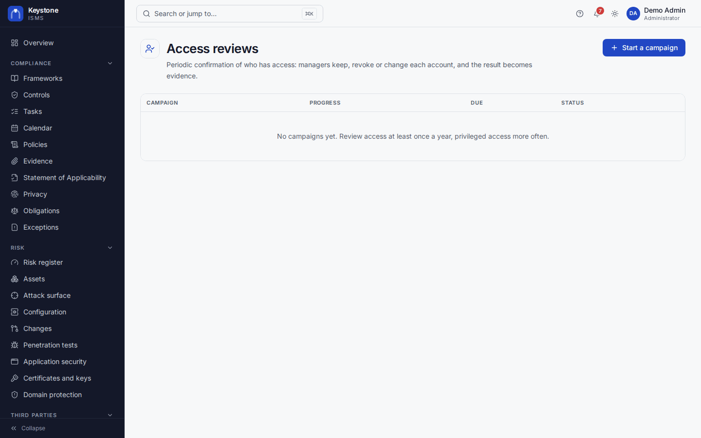

Access reviews (ISO 27001 A.5.18) confirm who has access to what.

1. **Start a campaign**: give it a title, choose whose accounts to review (Keystone's own accounts and roles, or
   accounts from connected identity sources such as Microsoft 365), a due date, an owner and whether it **repeats**
   every 3, 6 or 12 months. A repeating campaign starts the next one by itself.
2. Each reviewer decides **Keep**, **Revoke** or **Change** for the accounts they review (*Only items I review* filters
   to yours), saying what should change where needed.
3. **Complete campaign** files the result as evidence. **Export** downloads the decisions for auditors.

### Leaver access check

**Trust and people → Leaver access check** compares People with every account Keystone can see (Keystone's own
accounts and the identity sources connected under Integrations), and lists:

- **Leavers with access** (high): someone who is offboarding, offboarded or past their end date, whose account is
  still active.
- **Guest accounts** with nobody behind them.
- **Accounts with no person** in People: a service or shared account, or someone missing from People.

Nothing is changed here: **Open** goes to the account, and you deactivate it in Users or in the source system. For a
service or shared account, **Expected** records why it has no person and stops listing it; **Check again** undoes
that. Needs the access-review permission (administrators and ISMS managers).

### Trust Center

The Trust Center is a public page that shows customers how you protect their data.

- **Settings**: the overview text and the frameworks to show. Set each framework to *Aligned*, *Certified* (only with a
  current certificate or attestation report) or *Hidden*. The page says that alignment is not certification.
- Only controls that are implemented with current evidence appear, and they drop off automatically if they stop
  passing. Published policies, **Subprocessors** and **FAQ** can be shown too.
- **Documents** can be public or **on request**: the requester asks on the public page, signs an NDA if you require
  one, and once you approve under **Access requests** receives a private link that expires after 1 to 365 days (by
  email when email is set up). You can revoke access at any time.
- **Published** turns the public page on and off; **Open public page** shows it.

### Customer questionnaires

Answer the security questionnaires customers send you.

1. **New questionnaire**: upload the customer's file (`.xlsx` or `.csv`) or paste the questions. Keystone finds the
   question column and any answer column.
2. Answer each question:
   - **Fill from the knowledge base**: close matches to approved answers are filled in, and similar ones suggested.
   - **Draft with AI** (when AI is on): Claude drafts answers from your approved policies and knowledge base, with
     quoted sources. Answers marked *No verified source* need particular care.
   - Or write the answer yourself.
3. A person approves every answer.
4. **Export** writes the approved answers into the customer's own spreadsheet. Add good answers to the **Knowledge
   base** so the next questionnaire is faster.

### Integrations

Integrations connect Keystone to your tools, read-only.

- **Control checks** (website and TLS, GitHub, AWS, Entra ID) run on a schedule. Passing checks become evidence on
  their controls; a failing, erroring or unknown check makes the control not ready.
- **Attack surface sources** (Microsoft 365, EDR, RMM and vulnerability scanners) feed [Attack surface](#attack-surface).
- **Connect** shows a setup guide with commands to create a read-only credential. **Test connection** tries the
  settings without saving anything.

---

## 9. Operations

### Security reports

Employees report suspicious emails, lost devices, open doors and anything else from **Report something suspicious** in
their portal (ISO 27001 A.6.8). Incident handlers are notified, and **Operations → Security reports** lists every
report. A report where someone clicked a link or entered a password is marked **Clicked**: act on those first.

Open a report and either:

- **Open an incident**: choose the severity; Keystone opens an incident with the report's details and links them, or
- **Close with a reply**: phishing blocked, not a threat, or a duplicate, with a message to the reporter.

The reporter sees the outcome and your reply in their portal, but not the incident itself.

### Incidents

Report incidents as soon as you know about them (ISO 27001 A.5.24 to A.5.28). **Report incident**, then work it through
**triage, containment, eradication and recovery**, adding timeline entries as you go (entries can't be edited later).

- **Notification deadline.** If personal data is involved, Keystone shows the regulator-notification deadline (72
  hours by default). **Record notification** when it's done.
- **Playbook**: a checklist for the incident's category. Tick steps as they're done; Keystone records who and when.
- **Response actions** with owners and due dates. An incident can't close as resolved while actions are open.
- **Evidence**: files are fingerprinted (SHA-256) when added and checked on every download, and each download is
  recorded (chain of custody). Only incident handlers can download them.
- **Linked records**: link the risk that materialised (its review comes forward), **Raise nonconformity** from the
  lessons learned, or open a ticket.
- Closing needs a root cause and lessons learned, and no outstanding required notification. Only an incident still in
  triage, and never contained, can be closed as a false positive or duplicate.

### Business continuity

Three tabs (ISO 27001 A.5.29 and A.5.30):

- **Business impact analysis**: each process's criticality, impact of an outage, maximum tolerable disruption (MTPD),
  RTO and RPO, the systems and suppliers it depends on, and manual workarounds. Critical and high processes without a
  plan are flagged.
- **Plans**: which processes each plan covers, the recovery strategy, who activates it, and how often it must be
  tested. A plan never tested is due now.
- **Tests**: **Plan a test** (tabletop, walkthrough, simulation, backup restore or full interruption), then **Record
  result** with the recovery time and data loss achieved for each process. Keystone compares them with the RTO and
  RPO, won't record a pass if an objective was missed, files evidence, and can raise a nonconformity in one step.

### Nonconformities

A nonconformity is something that doesn't meet a requirement (ISO 27001 10.2). They come from audits, incidents,
tests or your own observations (**Raise nonconformity**).

1. Record the **containment** (what you did straight away).
2. Find the **root cause**, recording the method (5 whys, fishbone, fault tree or other). Keystone warns when similar
   nonconformities appeared in the last three years, so you can check whether earlier actions worked.
3. Add **corrective actions** with owners and due dates, and complete them.
4. Someone other than the action's owner and whoever completed it **checks each action was effective**. An
   ineffective action sends the nonconformity back for a new plan.

### Audits

Plan and run internal audits (ISO 27001 9.2), and record external, certification and supplier audits.

1. **Plan audit**: the type, dates, lead auditor and the controls in scope. Auditors can't audit controls they own.
2. Record **findings**: conformity, observation, opportunity, minor or major nonconformity. Major and minor findings
   open nonconformity records automatically. Findings can be edited while the audit is in progress or reporting.
3. **Evidence requests** let an auditor ask for evidence; people who manage evidence answer by linking evidence and a
   note, and the auditor accepts or reopens each request. Only answered requests can be accepted, and not by whoever
   answered them.
4. **Audit pack (ZIP)** holds the SoA, approved policies, current evidence for the audit's controls and everything
   linked to requests, with a manifest of SHA-256 hashes.

External auditors get an **Auditor** account with an expiry date, set up by an administrator.

The **Programme** tab shows, for each applicable control, when it was last audited in the three-year cycle and when
it's next planned. Tick *Only controls neither audited nor planned* to see what to plan next.

### Management review

**Prepare review** creates a management review (ISO 27001 9.3) with the 9.3.2 inputs compiled from live records:
previous actions, changes in issues, nonconformities, monitoring results, audits, objectives, risks, incidents and
third parties. Record attendees and decisions, track decisions as improvement items, and **finalise**. Finalised
reviews are frozen.

### Workload

Open, overdue and upcoming work per person, what needs their attention, and how many controls and risks each owns.
The last row shows what nobody owns yet. Use it to spot overload and gaps before they become overdue.

### Reports

- **Board summary** (PDF or Word): one page for management with readiness, how the headline figures moved over 12
  weeks, top risks and what needs a decision.
- **Registers** as Excel: risks, assets, vendors, incidents, nonconformities, the audit log, and each framework's
  Statement of Applicability (Excel or Word).
- **Scheduled emails** (people who manage organisation settings): send a report weekly, monthly or quarterly to chosen
  Keystone users. Outside addresses can't be added.

Exports are recorded in the audit log. Treat them as confidential.

### Physical security

**Operations → Physical security** covers ISO 27001 A.7:

- **Sites and secure areas**: offices, server rooms, data centres and stores, with their security zone (public,
  internal, secure, restricted), physical controls and the assets kept there.
- **Physical security checks**: regular checks of CCTV, alarms, access control, fire protection, power and cooling,
  and of who holds badges and keys. Give each one how often it's due; **Record as OK** or **Record issues** sets the
  last check to today and works out when the next one is due.
- **Visitor log** (people who manage assets only): visitors to secure areas, their host, when they arrived and
  **Signed out**.

---

## 10. Settings

Everyone has **Organisation** (read-only unless you can change it) and **My account**. The other tabs depend on your
role.

| Tab | For | What it does |
|---|---|---|
| **Organisation** | ISMS managers | Context, scope, interested parties, roles and objectives (see [Setting up](#3-setting-up-the-isms)) |
| **Users** | Administrators | Add staff accounts, change roles, set expiry dates (auditors must have one), reset passwords, disable accounts. Accounts are never deleted, so the audit trail stays intact |
| **Audit log** | Administrators, ISMS managers, auditors | Every change to ISMS records, sign-ins and exports, append-only and hash-chained. The banner shows whether the chain is intact |
| **AI** | Administrators | Turn the optional AI features on or off and set limits. The panel lists exactly what is sent for each feature |
| **Email** | Administrators | The SMTP relay for digests, invitations and links |
| **Chat and webhooks** | ISMS managers | Send important events to Slack, Microsoft Teams or your own systems |
| **Single sign-on** | Administrators | Microsoft Entra ID, Google or Okta sign-in, and "require single sign-on" |
| **Provisioning** | Administrators | SCIM tokens so your identity provider creates and disables accounts |
| **System health** | Administrators | Database, scheduler, virus scanner, email, scheduled jobs and backups (see the admin guide) |
| **My account** | Everyone | Profile, password, notification preferences |

---

## 11. The employee portal

Employees (and anyone, from **My employee portal** in the account menu) see what's left for them to do:

- **Report something suspicious**: a strange email, a lost device, someone you don't recognise. Tick the box if you
  clicked a link or typed your password; nobody will blame you. The security team's reply appears under it.
- **Your progress** across everything below.
- **Policies to accept**: **Read and accept** opens the policy; sign by typing your full name and confirm. A new
  major version asks you again.
- **Security training**: short modules with a quiz. A pass lasts a year; due dates are shown on each module.
- **Device security**: **Add device** and confirm each work device meets the basics: disk encryption, automatic screen
  lock, anti-malware, automatic updates, firewall and the company password manager. You can attach a screenshot. A
  device marked *Needs attention* lists what's still to confirm. Renew it every six months.
- The bell shows reminders; **Tour** shows the portal tour again.

Employees can't see any other part of Keystone.

---

## 12. Phones, tablets and dark mode

| | |
|---|---|
|  |  |

On a phone the sidebar is behind the **menu** button (top left), tables show one card per record, and dialogs open
full screen. Everything works the same way.

Choose **Light**, **Dark** or **System** with the theme button in the top bar. Keystone remembers your choice on each
device.
